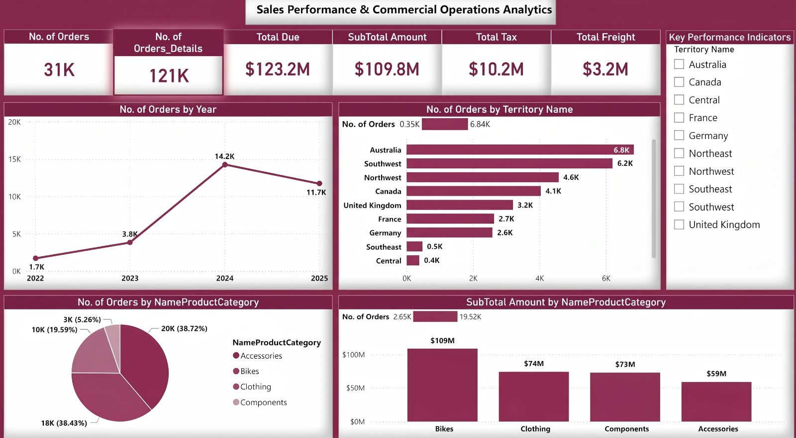

# 💰 Sales Performance & Commercial Operations Analytics
### Enterprise Sales Intelligence Dashboard – Power BI

## 📌 Overview
End-to-end commercial analytics dashboard analyzing **31K orders / 121K order details** with **$123.2M Total Due**. Built to track sales performance, territory growth, and product category profitability.

## 📊 Executive KPIs
| KPI | Value |
| :--- | :--- |
| **No. of Orders** | **31K** |
| **No. of Orders Details** | **121K** |
| **Total Due** | **$123.2M** |
| **SubTotal Amount** | **$109.8M** |
| **Total Tax** | **$10.2M** |
| **Total Freight** | **$3.2M** |

## 📈 Key Insights
- **Peak Year:** 2024 with 14.2K orders (733% growth from 2022)
- **Top Territory:** Australia 6.8K, Southwest 6.2K
- **Top Category by Orders:** Accessories 20K (38.72%) & Bikes 18K (38.43%)
- **Top Category by Revenue:** Bikes $109M – highest average order value

## 🖥️ Dashboard Preview

## 🛠️ Tools & Technologies
- Power BI Desktop, DAX, Power Query, Data Modeling

## 👩‍💻 Author
**Nermeen Elsayed Farg** – Agricultural Economist | Data Analyst
- [LinkedIn](https://linkedin.com/in/nermeen-farg) | [GitHub](https://github.com/nermeenfarg)

---
⭐ Star this repo if you find it insightful!
